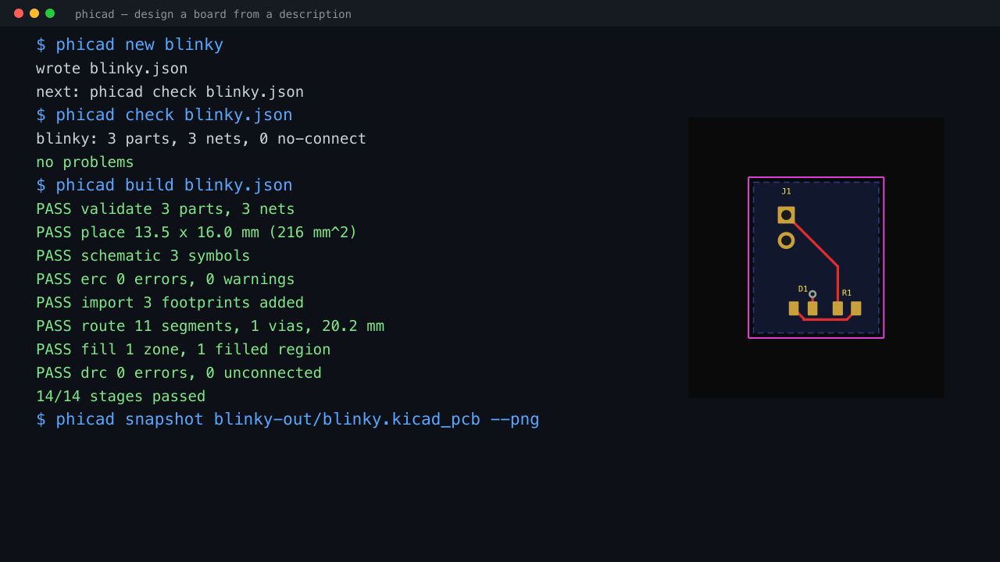
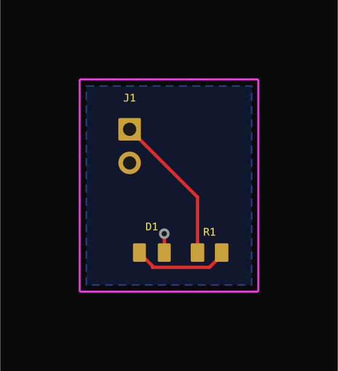
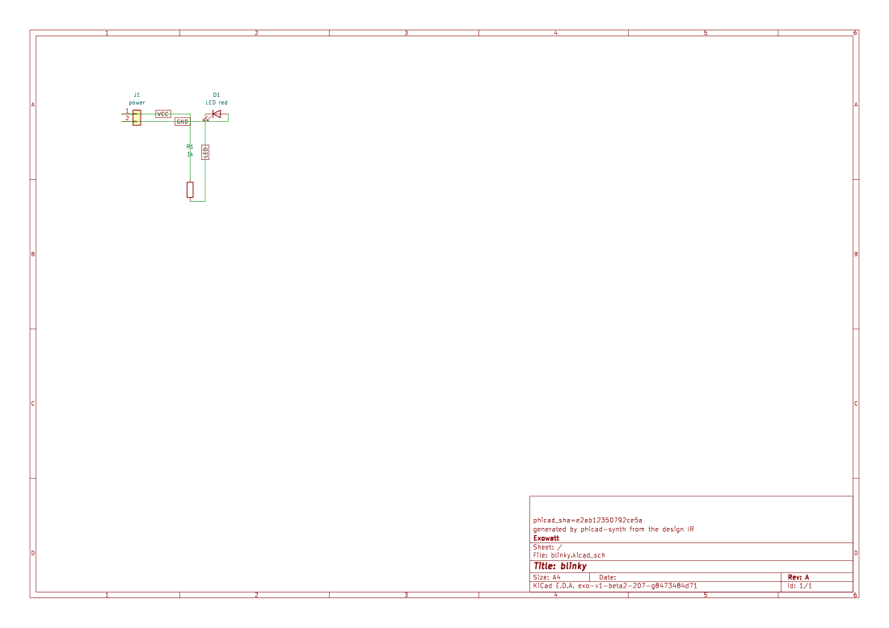
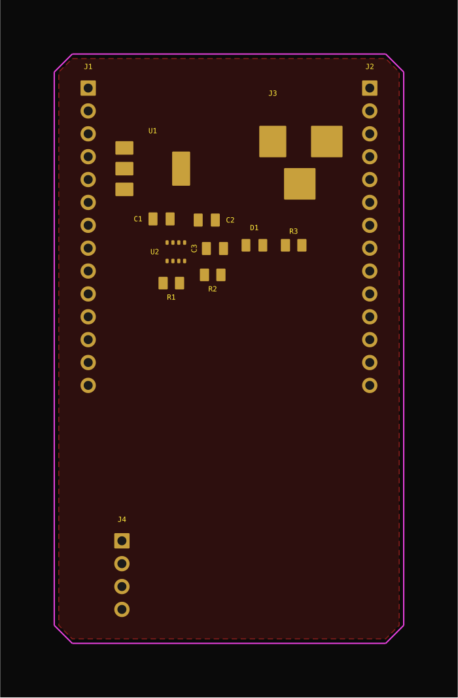
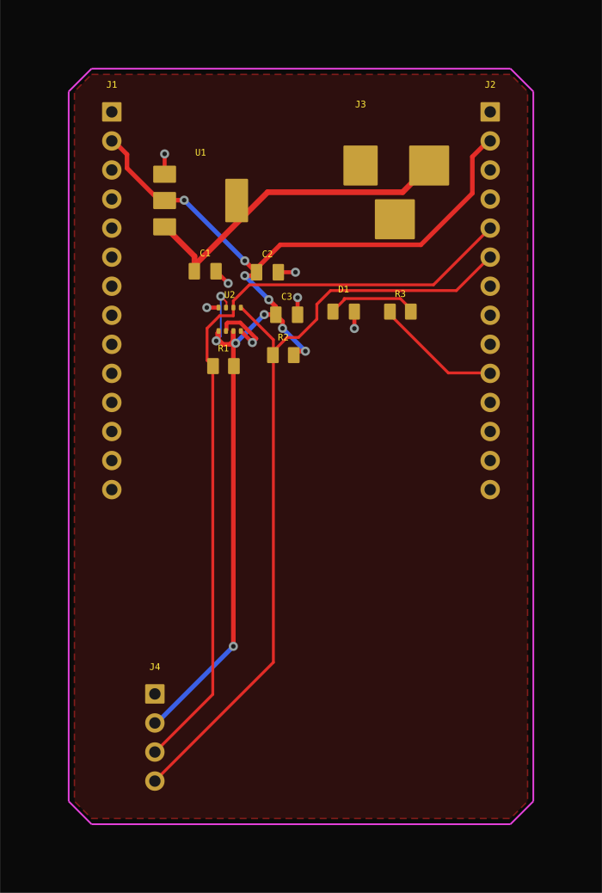

<div align="center">

# PhiCad

**Describe a board. Get a routed, gate-checked KiCad project.**

A fork of [KiCad](https://kicad.org) 10 — the whole EDA suite, plus
a layer that compiles a design description into a real board and then checks its own work with the
same tools a human would use. Project files and native builds stay local by default; agent requests
use the user's own authenticated phi connection and can leave the machine.

</div>

```bash
phicad new blinky            # a design that builds as-is
phicad build blinky.json     # place, route, pour, then gate it
```

<div align="center">
  <a href="docs/media/cli-demo.mp4">
    
  </a>
  <p><em>Real output from those two commands — 14 of 14 gates, DRC clean.
  <a href="docs/media/cli-demo.mp4">Play the 10-second demo →</a></em></p>
</div>

## What comes out

The 3-part scaffold `phicad new` writes, compiled with no hand edits: **13.5 × 16.0 mm, 11 track
segments, 1 via, poured ground plane, DRC 0 errors and 0 unconnected**.

<table>
<tr><td align="center"><b>The board</b></td><td align="center"><b>Its schematic</b></td></tr>
<tr>
<td></td>
<td></td>
</tr>
</table>

Both are ordinary KiCad files — open them in PhiCad or stock KiCad and edit them by hand. The
schematic is fingerprinted, so a rebuild **refuses to overwrite your edits** instead of silently
discarding them.

### A larger one

A 13-part, 4-layer Teensy carrier — regulator, BME280, I²C breakout, status LED — through the same
pipeline: 40.6 × 66.1 mm, 134 segments, 18 vias, 12 ground stitches.

<table>
<tr><td align="center"><b>Placed</b></td><td align="center"><b>Routed</b></td></tr>
<tr>
<td></td>
<td></td>
</tr>
</table>

This one stops at **13 of 14 gates**: DRC finds a real short that the router reported as routed.
That failure is documented rather than hidden — a generated board is a draft to review, not a fab
release.

## Every gate says what it found, and where

A verdict with no evidence forces you to re-derive what the tool already knew, so findings are
data — code, severity, the items, the layer, the coordinate, and what to change:

```
[08b5f9347aad] error  drc.shorting_items
    Items shorting two nets (nets 3V3 and VIN)
    refs: Pad 2 [3V3] of U1 on F.Cu, Track [VIN] on F.Cu, length 9.0510 mm
    at:   (114.69, 111.53) mm  on F.Cu
    fix:  move one of the two items apart, or put them on the same net
```

The leading id is **stable across runs**, so a waiver you grant stays granted. It ignores the
wording of the message and a sub-micron nudge, and changes when the violation actually moves.

## Getting started

```bash
phicad bootstrap                  # dependencies (macOS: Homebrew, Debian/Ubuntu: apt), one time
phicad configure dev && phicad build   # ~3.5 h cold, 16 GB RAM
phicad doctor                     # what is missing?
phicad --version                  # source tag/commit plus runnable native version
phicad support bundle             # reviewable, privacy-safe support snapshot
phicad help                       # the short list
phicad help all                   # every command
```

| Read | For |
| --- | --- |
| [Getting started](docs-site/docs/guides/getting-started.md) | install, the design format, the gates, known limitations |
| [Product tour](docs-site/docs/guides/product-tour.md) | the visual intent-to-fabrication workflow |
| [Feedback and privacy](docs-site/docs/guides/feedback.md) | report a bug, request a feature, and share diagnostics safely |
| [`git-workflow.md`](git-workflow.md) | working on the fork — start here |
| [below](#branch-policy-release--integration) | fork, branch, and upstream policy |
| [`architecture.md`](architecture.md) | where code lives in a 3400-target tree |
| [`ai-interfacing.md`](ai-interfacing.md) | IPC API, kipy, MCP, jobsets |
| [`synth/README.md`](synth/README.md) | the design IR and its gates |

## PhiCad Verify — code-defined designs

A second, newer path into the same fork: author a board as a tscircuit `.tsx` file, build it with
the pinned engine, and check the exported board with **this fork's own DRC**.

```bash
cd phicad/core && bun install          # pinned engine, from the committed lockfile
phicad core capabilities               # what this machine can do, and tool versions
phicad core build design.tsx           # build, then check independently
```

```console
PASS  engine        2 components, 4 pads, 2 traces, 18 x 12 mm  (3 warnings)
FAIL  kicad drc     5 errors, 4 warnings
  [995b532f9437] error  drc.clearance
      Clearance violation ( clearance 0.2000 mm; actual 0.1569 mm)
```

Two engines, **two verdicts, never merged** — a tool's opinion of its own output is not an
independent check. The KiCad step evaluates the board against the rules recorded in the exported
file; it is not a fabrication-readiness verdict.

Also available as MCP tools (`verify_capabilities`, `verify_check`, `verify_build`,
`verify_manifest`, `verify_circuit_json`, `verify_launch_targets`, `verify_open_view`) so a phi
session can drive it. Full contract, limits and security posture:
[docs-site/docs/reference/phicad-verify.md](docs-site/docs/reference/phicad-verify.md).

Where this sits in the wider stack: **phi** is the only AI harness; **tscircuit** is the
pinned code engine; and **this repo** is one native authority that provides both **PhiCad
Studio** (the visual editing mode, plus manufacturing export via `kicad-cli pcb export`) and
**PhiCad Verify** (the independent check). `studio` and `verify` are two views of the same
installed application, not two products.

---

## What this is not

PhiCad does not minimise board area, choose your layer count, or pick your parts. Placement is a
shelf packer (~25 % copper fill on the boards above), `board.layers` is a plain input, and parts
come from the KiCad libraries you already have. It automates the tedious, checkable parts of a
board and then tells you exactly where it failed.

---

## Fork, branch and upstream policy

A full clone of upstream,
tracked in its own repository, worked on through worktrees, with a thin `phicad/` layer on top that
never touches upstream files.

| | |
| --- | --- |
| `origin` | https://github.com/couplet-physical-ai/PhiCad |
| `upstream` | https://gitlab.com/kicad/code/kicad.git (official; read-only for us) |
| Upstream base | KiCad 10.x development (`master` on GitLab) |
| Release checkout | `~/Documents/PhiCad-release` — branch `master` |
| Work worktrees | `~/Documents/PhiCad/<Topic>` — one per topic, branched off `dev` (`git worktree list` is the truth) |

## Branch policy (release / integration)

- **`master`** — the **release branch** and GitHub's default: what a fresh clone gets, always a
  state we consider shippable. Moves **only** by fast-forward from `dev` (`phicad release`).
  Never commit on it directly.
- **`dev`** — the integration branch. All work lands here first via PRs; upstream merges land
  here first too. When `dev` is validated (build + narrow tests), it is released to `master`.
- **`upstream/master`** (remote-tracking ref) — the pristine upstream pointer. We no longer keep
  a local mirror branch of it; `git fetch upstream` maintains the ref, `phicad status` reports
  the delta, and upstream code is merged `upstream/master → dev`.
- Feature work — a worktree off `dev`
  (`git worktree add ~/Documents/PhiCad/wt-<name> -b <type>/<name> origin/dev`),
  or a worktree managed by your agent host. PRs target `dev`.

```
upstream/master ──merge──> dev (integration, PRs) ──ff-only release──> master (default, clones)
```

History note: until 2026-09-02 `master` was a pristine upstream mirror and the working branch was
called `Main`. `Main` was renamed to `dev` (GitHub retargeted open PRs automatically) and `master`
was fast-forwarded onto it, making the default branch the release. The old "switch branches after
clone" step is gone — clones just work.

## The `phicad/` layer

Everything PhiCad-specific is confined to this directory (plus a few documented hooks into KiCad sources), so upstream
merges stay conflict-free:

| Path | What it is |
| --- | --- |
| `phicad/bin/phicad` | the only entry point you need: bootstrap, configure, build, test, fmt, sync |
| `phicad/CMakePresets.json` | macOS + Linux presets, copied to the (gitignored) root `CMakePresets.json` by `phicad bootstrap` |
| `phicad/build-macos.md` | dependency list, the three mandatory macOS cmake overrides, build costs |
| `phicad/build-linux.md` | Debian/Ubuntu dependency list, the flat build-tree layout, RAM-capped parallelism |
| `phicad/loop/` | an optional continuous development loop on a build host: backlog items → phi → fork gates → PRs into `dev`, on a systemd timer ([README](loop/README.md)) |
| `phicad/testing.md` | QA suite map, exact test commands, style gates, automation surfaces |
| `phicad/architecture.md` | where every subsystem lives, path by path |

## Agent execution and improvement proposals

The [MCP surface](mcp/README.md) drives fork-native tools and an owned headless IPC child.
Background workflows do not require an open PhiCad window. See the
[current integration boundary](integration/README.md) for the phi-only Agent View adapter,
digest checks, and the planned workflow service.

The first slice restricts the exposed tool surface;
async jobs, API migration and broad design generation are separate future slices.

## Getting started

```bash
cd <your checkout>              # e.g. ~/Documents/PhiCad/MCP; `git worktree list` shows them
phicad/bin/phicad bootstrap      # deps + presets (one time)
phicad/bin/phicad configure      # build/mac-dev (macOS) or build/linux-dev (Linux)
phicad/bin/phicad build          # ~3.5 h cold and 16 GB; ccache makes later reruns cheap
phicad/bin/phicad --version       # release/source identity + native CLI version
phicad/bin/phicad test '^qa_kimath$'
```

Put it on PATH for convenience: `export PATH="$PWD/phicad/bin:$PATH"` from the checkout root.
The script defaults to its own checkout. MCP and automation entry points also honor explicit
`PHICAD_REPO`, `PHICAD_BUILD`, `PHICAD_VENV` and `PHICAD_KICAD_CLI` overrides for separate source
and build worktrees. Inspect doctor/status output and MCP registration environment before use.

To exercise the macOS install rules rather than the development bundle, use a separate full
release build and the clean-prefix smoke:

```bash
phicad/bin/phicad configure release
PHICAD_BUILD=build/mac-release phicad/bin/phicad build
phicad/bin/phicad install
```

The last command recreates only `build/install/mac-release`, verifies the installed bundle and
its ad-hoc signature, and runs the installed CLI without build-tree overrides. This is Apple
Silicon macOS staging evidence, not a DMG, notarization, Gatekeeper, GUI-launch, or cross-platform
qualification; [build-macos.md](build-macos.md#clean-stage-release-smoke-macos-only) records the
prerequisites and limits. The [release-one readiness runbook](docs-site/docs/reference/release-readiness.md)
adds the required review, signing, notarization, asset, documentation, and rollback gates.

For a bug report, generate a local archive only after reviewing the
[feedback data boundary](docs-site/docs/reference/feedback-privacy.md):

```bash
phicad/bin/phicad support bundle
```

The default archive excludes credentials, arbitrary environment values, prompts, transcripts,
and project contents. `--project PATH` accepts only a recognizable KiCad/PhiCad project and adds
names, sizes, and SHA-256 hashes—not file contents; broad or unrelated directories are refused.
The ZIP is written owner-readable/writable (`0600`); `--json` reports only its basename and archive
SHA-256 so the attachment can be referenced without disclosing a local path.

## Syncing with upstream / cutting a release

```bash
phicad/bin/phicad status    # how far behind upstream/master we are
phicad/bin/phicad sync      # fetch upstream, merge upstream/master -> dev (current worktree)
phicad/bin/phicad build     # rebuild after the merge; run narrow tests for touched areas
phicad/bin/phicad release   # ff master -> dev tip in the release checkout, push
```

`sync` refuses to run with a dirty tree, so it is safe to run repeatedly. Merge conflicts with
upstream can only occur in the two files we share with upstream's paths (everything PhiCad-specific
lives under `phicad/`) — in practice conflicts come from upstream deleting
or moving files we merely *reference*. Resolve in the dev worktree, build, then release. Manual
equivalent:

```bash
git fetch upstream '+refs/heads/master:refs/remotes/upstream/master'
git merge upstream/master                  # in the dev worktree, on dev
git -C ~/Documents/PhiCad-release merge --ff-only origin/dev   # release
git -C ~/Documents/PhiCad-release push origin master
```

## Gotchas behind an HTTPS proxy

If your environment exports `HTTPS_PROXY`/`ALL_PROXY` pointing at an LLM gateway or another
non-general proxy, `phicad` strips those variables for every network command; do the same by hand:

```bash
env -u HTTPS_PROXY -u https_proxy -u ALL_PROXY -u all_proxy -u HTTP_PROXY -u http_proxy <cmd>
```

GitHub refuses a single push larger than 2 GB: push the full KiCad history in stages
(for example `~40000` commits, `~20000`, then the tip) when seeding a new remote.

## Licensing

KiCad is GPL-3.0-or-later (`LICENSE`, `LICENSE.README` for per-file exceptions); PhiCad's changes
and this `phicad/` layer are distributed under the same terms. Keep upstream copyright headers
intact in files you modify. KiCad is a trademark of the KiCad project.

### Third-party components

| Component | Licence | How it is used |
| --- | --- | --- |
| `tscircuit`, `@tscircuit/cli`, `@tscircuit/eval` | MIT | pinned build engine in `phicad/core`, invoked as a binary — not vendored |
| `circuit-json` | see upstream | build/interchange schema |
| Freerouting | see `phicad/autoroute/` | autorouting, invoked as a binary |
| JLC2KiCadLib | MIT | LCSC/JLCPCB symbol+footprint+3D download in `phicad/parts/fetch_part.py`, invoked as a subprocess — the default parts backend |
| easyeda2kicad | AGPL-3.0 | **fallback only, for one release**, in `phicad/parts/fetch_part.py`: a separately installed subprocess (never vendored, no AGPL code in this tree) that is used only when JLC2KiCadLib is missing, and only with a printed licence warning. Removal is tracked in `phicad/parts/README.md`. |
| PhiCad Studio | GPL-3.0-or-later | **The same native application as Verify**, in its Studio editing mode — not a separate repository. No AGPL-licensed code is present in this tree, and none may be added without a licensing review. |

Exact installed engine versions are reported by `phicad core capabilities --json`.
