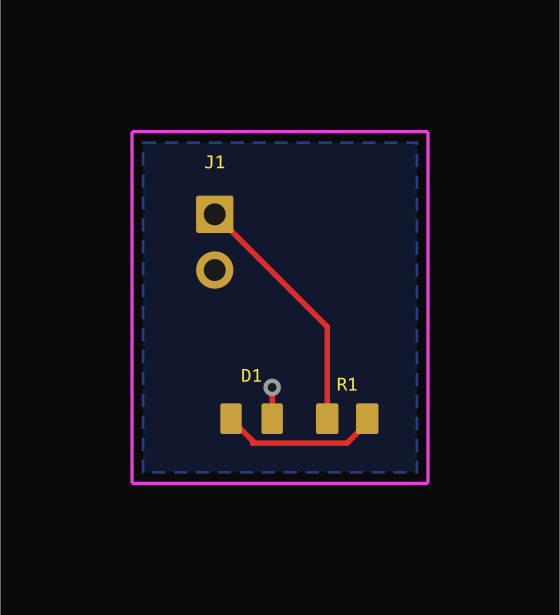
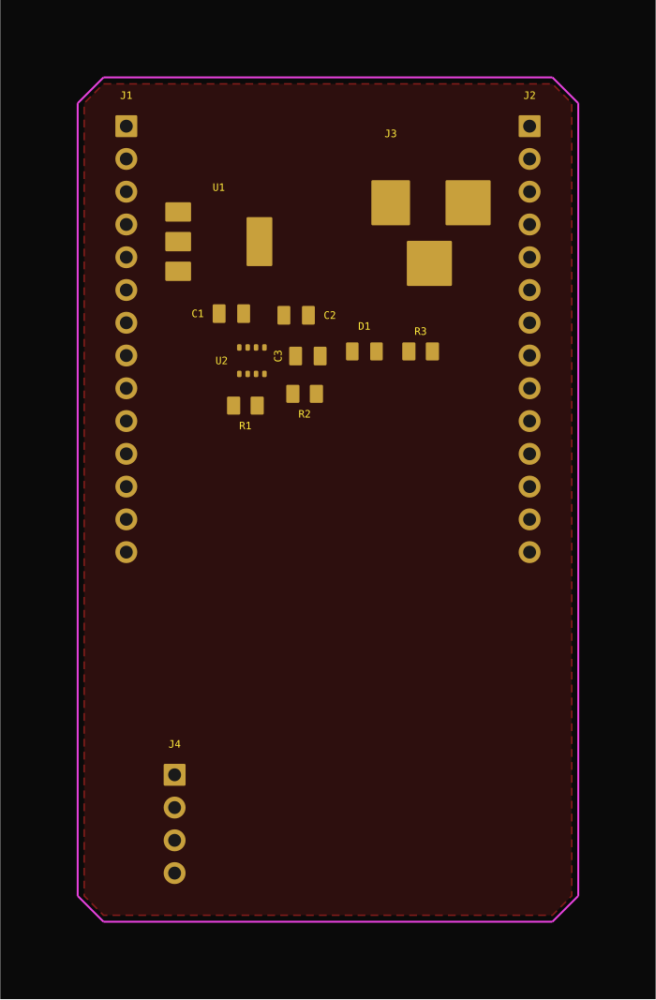
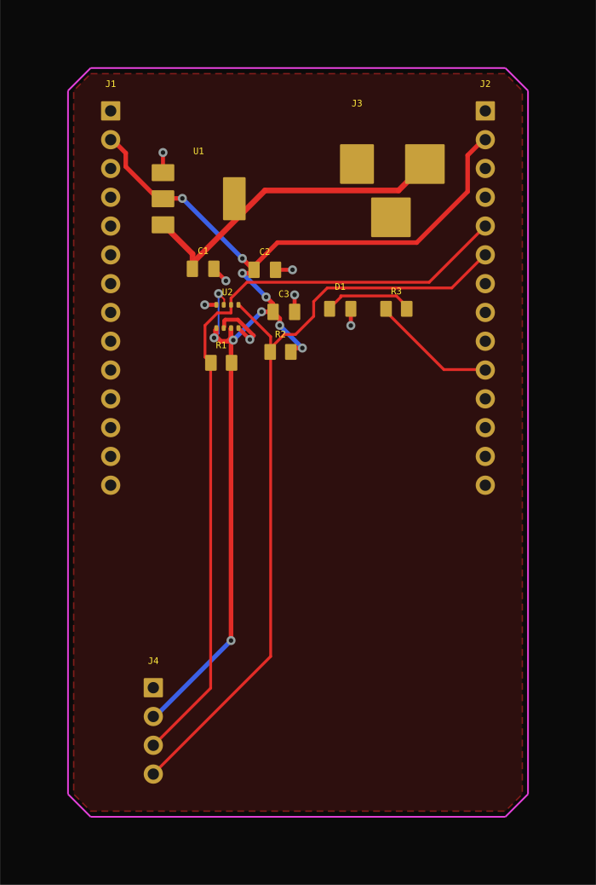
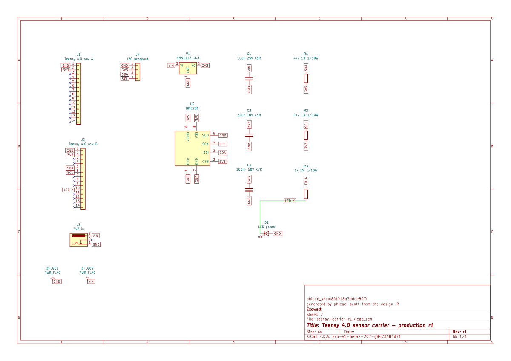

# Getting started

PhiCad is a fork of KiCad 10 with a layer that turns a **written description of a
circuit** into a placed, routed KiCad project — and tells you, gate by gate, what it could and
could not prove about the result.

This page is the honest tour: what works today, what it looks like, where it stops, and how to
drive it yourself. Every number and screenshot here was produced by running the commands on
this page.

## Pick a path

<div class="grid cards" markdown>

- :material-rocket-launch: **New user — make a first board**

    Follow this page from [install](#install) through the real gates, then keep the generated
    project as a reviewable starting point.

- :material-monitor: **Desktop user — see the application**

    Take the [visual product tour](product-tour.md), then launch [The application](the-application.md)
    from the build tree.

- :material-robot-outline: **Agent operator — drive it headlessly**

    Go to [Driving PhiCad](driving-phicad.md) for MCP, `phicad tool`, Python, IPC, and raw
    `kicad-cli` examples.

</div>

## What you get

<video controls muted playsinline preload="metadata"
       poster="../../assets/getting-started/phase3-routed.png"
       style="width:100%;max-width:900px;border-radius:8px">
  <source src="../../assets/getting-started/pipeline-demo.mp4" type="video/mp4">
  Your browser cannot play this video; the same output is in the table below.
</video>

That is one real run of `phicad synth build` on the example design in this guide. Fourteen
stages, each one a gate that passes or fails on its own evidence. [Read the pipeline transcript](#pipeline-demo-transcript)
if you cannot play the video.

<details id="pipeline-demo-transcript">
<summary>Pipeline demo transcript</summary>

The recording shows a real `phicad synth build` moving through the synthesis pipeline. The
terminal output advances through validation, placement, schematic emission, import, connectivity,
positioning, outline, routing, silk, fill, and DRC. The rendered placed and routed board is the
same output shown later on this page. The final DRC result is evidence to inspect; it is not
silently converted into a success headline.

</details>

## Install

macOS on Apple silicon is the supported path.

```bash
git clone https://github.com/couplet-physical-ai/PhiCad.git
cd PhiCad
phicad/bin/phicad bootstrap        # Homebrew dependencies, one time
phicad/bin/phicad doctor           # verify the toolchain
phicad/bin/phicad configure dev    # CMake configure into build/mac-dev
phicad/bin/phicad build kicad-cli  # ~873 steps
```

Budget **~20 GB of disk** and a long first build. A full `phicad build` is ~3,431 steps and
around 3.5 hours on 10 cores; building just what you need is much faster.

For the generation pipeline you also need the automation venv and the editor plug-ins:

```bash
phicad/bin/phicad venv                                  # kipy + s-expression tooling
phicad/bin/phicad build eeschema_kiface pcbnew_kiface cvpcb_kiface
```

The steps above give you the **command-line** tools. To open the desktop application you also
have to link the GUI, which is a separate target:

```bash
phicad/bin/phicad build kicad       # links build/mac-dev/kicad/PhiCad.app/Contents/MacOS/PhiCad
phicad/bin/phicad open              # opens the app from the build tree
```

!!! warning "`PhiCad.app` exists before the app does"
    Configuring the tree creates `build/mac-dev/kicad/PhiCad.app/` and fills in the editor
    plug-ins, but the **GUI executable inside it is only written by the `kicad` target**. A
    bundle with no executable cannot launch, so `phicad open` checks for the binary itself and
    tells you to run `phicad build kicad` when it is missing.

`phicad doctor` reports exactly which of the three artifacts you have:

```text
==> build tree /Users/you/PhiCad/build/mac-dev
  GUI app       ok (…/PhiCad.app/Contents/MacOS/PhiCad)
  kicad-cli     ok
  kifaces       6/6 editor plug-ins
```

It also executes `kicad-cli version`. If the binary exists but terminates before returning a
version, doctor reports `BUILT BUT WILL NOT RUN` without aborting its own diagnostic. A named
loader error points to dependency drift and a rebuild; a crash with no loader diagnostic should
first be retried from a logged-in desktop shell so a broken macOS login/bootstrap session is not
mistaken for a bad link.

!!! note "Behind the LLM proxy"
    Every `*_proxy` variable points at the LLM gateway, so `git`, `brew` and `gh` fail until
    it is stripped. `phicad` already does this internally; for your own commands use
    `env -u HTTPS_PROXY -u https_proxy -u ALL_PROXY -u all_proxy -u HTTP_PROXY -u http_proxy <cmd>`.

Check the fork layer at any time with `phicad/bin/phicad check fast` (~40 s, no build).

!!! note "Privacy-safe diagnostics"
    When a report needs more than prose, generate a local, reviewable archive with:

    ```bash
    phicad support bundle [--project PATH] [--output PATH] [--json]
    ```

    The optional project input adds names, sizes, and hashes—not board or schematic contents.
    Review the archive before attaching it through the [feedback guide](feedback.md).

## The design IR

A design is one JSON file. Here is the complete power section of the board used throughout this
page:

```json
{
  "project": "teensy-carrier-r1",
  "title": "Teensy 4.0 sensor carrier — production r1",
  "board": {
    "layers": 4,
    "outline": "auto",
    "margin": 2.0,
    "part_gap": 1.6,
    "corner": { "chamfer": 2.0 },
    "ground_net": "GND",
    "pour_ground": true
  },
  "rules": {
    "clearance": 0.2,
    "track_width": 0.25,
    "track_widths": { "VIN": 0.5, "3V3": 0.4, "GND": 0.35 }
  },
  "parts": {
    "U1": {
      "footprint": "Package_TO_SOT_SMD:SOT-223-3_TabPin2",
      "value": "AMS1117-3.3",
      "symbol": "Regulator_Linear:AMS1117-3.3",
      "lcsc": "C6186"
    },
    "C1": { "footprint": "Capacitor_SMD:C_0805_2012Metric", "value": "10uF 25V X5R" }
  },
  "placement": {
    "U1": { "group": "power" },
    "C1": { "near": "U1", "within": 3.0, "group": "power" }
  },
  "nets": {
    "VIN": ["J3.1", "U1.3", "C1.1"],
    "3V3": ["U1.2", "C2.1", "C3.1", "U2.2"]
  },
  "no_connect": ["J2.3", "J2.4"]
}
```

Two things to notice, because both are easy to get wrong:

**Placement constraints go in the top-level `placement` block, not inside a part.** A `near` or
`edge` key written inside `parts` is rejected with the correction spelled out:

```
error: parts.J1: 'edge' belongs in the top-level "placement" block, not inside a part
    hint: "placement": { "J1": { "edge": "west" } }
```

**`edge` takes a compass direction** — `north`, `south`, `east`, `west`. Not `left`.

You describe *intent*, not coordinates: `near` with `within`, `group` to keep a cluster
together, `edge` to pin a connector to a board edge. Nothing in the IR is an X/Y position.

## Your first board

The short way — `new` writes a design that builds as-is, so the first run succeeds:

```bash
phicad new blinky            # writes blinky.json
phicad check blinky.json     # validate, milliseconds
phicad build blinky.json     # the full pipeline -> blinky-out/
phicad snapshot blinky-out/blinky.kicad_pcb --png
```

That scaffold reaches **14 of 14 gates, DRC clean**, at 13.5 × 16.0 mm:



There is also `phicad dev blinky.json`, which runs check → build → render and then waits for the
file to change and does it again — one command to leave running while you edit the design.

<details id="cli-demo-transcript">
<summary>CLI demo transcript</summary>

The recording shows the terminal running `phicad new blinky`, validating the generated
`blinky.json`, and running `phicad build blinky.json`. The pipeline places and routes the board,
then reports the gate result before the rendered board is inspected. The output is the same
Blinky project pictured above; the command sequence is intentionally copyable rather than a
simulated UI flow.

</details>

The longer forms still work and are what the rest of this guide uses, because they show which
piece does what:

```bash
phicad/bin/phicad synth check  design.json            # validate only, milliseconds
phicad/bin/phicad api-server &                        # IPC server the build talks to
phicad/bin/phicad synth build  design.json -o out/    # the full pipeline
```

`synth check` is worth running on its own — it is fast and it is where most mistakes surface:

```
teensy-carrier-r1: 13 parts, 7 nets, 22 no-connect
no problems
```

It is a real electrical check, not a schema check. On the board on this page it caught two
mistakes in the author's own design: a pad assigned to two nets at once, and a barrel-jack
symbol whose pin count disagreed with its footprint's pads.

```
error: nets.LED_K: R3.2 is already on net 'LED_A'
    hint: a pad belongs to exactly one net; remove it from one of them
error: parts.J3: symbol Connector:Barrel_Jack and footprint BarrelJack_Horizontal disagree
       — footprint pads with no symbol pin: 3
    hint: symbol pins: 1, 2; footprint pads: 1, 2, 3
```

## What the pipeline actually does

Each stage is a gate with its own evidence. This is the real output for the 13-part carrier:

| Stage | Result |
| --- | --- |
| `validate` | 13 parts, 7 nets |
| `place` | 40.6 × 66.1 mm (2684 mm²), no courtyard overlaps |
| `scaffold` | `.kicad_pcb`, `.kicad_pro`, `.net` |
| `schematic` | 13 symbols, 39 labels |
| `erc` | 0 errors, 1 warning (`pin_to_pin`) |
| `sch-netlist` | 7 nets match the design pad for pad |
| `import` | 13 footprints added, 0 errors |
| `connectivity` | 7 nets match the design pad for pad |
| `position` | 13 placed |
| `outline` | 9 items: edge cuts, ground pour |
| `route` | 134 segments, 18 vias, 312.0 mm, 12 ground stitches, 1 necked |
| `silk` | 13 references placed, title |
| `fill` | 1 zone, 3 filled regions |
| `drc` | **2 errors**, 0 warnings, 1 unconnected |

**13 of 14 stages pass, and the last one is the point.** DRC found a real short — a `VIN` track
running into the regulator's `3V3` output pad — that the router believed it had routed
successfully. The pipeline reports the disagreement instead of hiding it. A generated board is a
draft to review, not a fabrication release.

### Placement, then routing



*After `place`: parts clustered by the `group` and `near` constraints, with the outline
shrink-wrapped around them.*



*After `route`, `fill` and `silk`: 134 segments, 18 vias, 12 ground stitches, and a ground
pour.*

Both images were rendered from the actual `.kicad_pcb` with
`phicad/demos/teensy-sensor-suite/plot_board.py`, which crops to the board extents in the
PhiCad dark theme.

### The schematic is real, and yours to edit

The generator writes a genuine `.kicad_sch` you can open in Eeschema: real symbols, pin
numbers, no-connect markers, a title block, and auto-inserted `PWR_FLAG`s.



*The generated schematic, opened in Eeschema. The green L-shaped wire between R3 and D1 is a
drawn connection; everything else is joined by net label. The `phicad_sha=` line in the title
block is the stamp that protects your edits.*

Two-pin nets get **drawn wires** when the path can be proven clear of every other symbol body
and pin; power and multi-pin nets stay on **labels**, where a net name beats a rat's nest of
lines. This is deliberately partial — a net whose wire cannot be proven safe keeps its labels,
because a schematic wire that grazes a foreign pin *connects* it, which is a short rather than a
cosmetic flaw. Connectivity is identical either way, verified with `kicad-cli sch export
netlist`.

**Your edits survive a rebuild.** The emitter is deterministic, so regeneration used to be
byte-identical — and silently destroyed anything you changed. It now stamps a digest of its own
output into the title block and refuses to overwrite a file that no longer matches:

```
FAIL  schematic — teensy-carrier-r1.kicad_sch has been edited since it was generated
                  — refusing to overwrite it
    hint: keep the edits and stop regenerating the schematic, or pass
          --overwrite-schematic to discard them
```

So the workflow is: generate, then take the schematic over by hand whenever you like.

## What "efficient" does and does not mean here

This is the question people ask first, so here is the measured answer.

**The outline is minimal. The packing is not.** `place` shrink-wraps the board edge onto
whatever it placed, so there is no wasted border. But the packer is a deterministic shelf
packer — tallest-part-first rows, target aspect ratio 1.3, courtyard legalisation — with **no
bin-packing search, no rotation search, and no area objective**. Measured copper-courtyard fill:

| Design | Board | Area | Courtyards | Fill |
| --- | --- | --- | --- | --- |
| `sensor-node.json` | 12.67 × 22.14 mm | 280.60 mm² | 74.29 mm² | **26.5 %** |
| `regulated-breakout.json` | 23.53 × 35.51 mm | 835.67 mm² | 201.51 mm² | **24.1 %** |

**Layer count is an input, not a decision.** `board.layers` defaults to 2 and is used exactly as
written. Nothing inspects the design and concludes it needs four layers, and nothing tries to
get it down to two. Since layer count usually dominates board cost, that is worth knowing
before you trust a generated stackup.

So: PhiCad is good at going from intent to a complete, reviewable, gate-checked project fast. It
is **not** an area or cost optimiser today.

## Which gate to believe

The gates do not all mean the same thing, and this matters more than anything else on this page.

| You see | It means |
| --- | --- |
| `PASS` | The gate ran and its evidence was good |
| `FAIL` | The gate ran and found a real problem |
| `SKIP` | An optional tool is genuinely absent (e.g. `ruff` not installed) |
| `BROKEN` | The gate could not run — **counted as failure**, never as a pass |

Two specific traps:

- **`kicad-cli pcb drc` exits 0 even when it finds violations.** Never judge DRC by exit code;
  read the report. The pipeline does this for you.
- **Warnings do not fail the synth gate.** The `erc` line above says `1 warnings` and still
  passes. Read the warning.

### Findings: what the gate found, not just that it failed

A summary line is enough to watch a build scroll past, but `FAIL drc — 2 errors` cannot be
clicked, filtered, waived, or repaired. So every gate that has structured output also emits
**findings**, and `--json` includes them with no extra flag:

```bash
phicad build design.json --json | jq '.stages[] | select(.findings) | .findings[0]'
```

```json
{
  "id": "08b5f9347aad",
  "code": "drc.shorting_items",
  "severity": "error",
  "message": "Items shorting two nets (nets 3V3 and VIN)",
  "refs": ["Pad 2 [3V3] of U1 on F.Cu", "Track [VIN] on F.Cu, length 9.0510 mm"],
  "where": "F.Cu",
  "at": { "x_mm": 114.69, "y_mm": 111.53 },
  "fix": "move one of the two items apart, or put them on the same net"
}
```

`id` is a digest of the code, the refs, and the position rounded to 1 µm — deliberately **not** of
the message. So:

| Change | Same `id`? |
| --- | --- |
| The message is reworded | Yes — a waiver you granted stays granted |
| A re-run nudges the track by a nanometre | Yes — same violation, same place |
| The offending track moves 30 mm | **No** — that is a different violation |

That is the whole guarantee, and its limit: identity tracks *where the problem is*, not how it was
phrased.

## Driving it from an agent

Everything above is available headlessly, which is the point of the fork:

```bash
phicad/bin/phicad api-server        # protobuf IPC server (kipy / kicad-python)
phicad/bin/phicad py script.py      # run a script against the venv
phicad/bin/phicad synth check d.json
```

There is also an MCP server exposing **123 tools** for agent hosts — see
[MCP tools](../reference/mcp-tools.md) and
[Driving PhiCad](driving-phicad.md).

## Known limitations

Stated plainly, because finding these out later is worse.

| Limitation | Detail |
| --- | --- |
| Generated boards are drafts | DRC found a real short in the example on this page |
| No area optimisation | Shelf packer; ~25 % fill on the shipped examples |
| Layer count not chosen | `board.layers` is used exactly as given |
| Router is modest | Built-in router; complex boards need `phicad autoroute` (Freerouting) |
| Schematic wires are partial | Two-pin nets only, and only when provably clear |
| Placement is not visually optimal | Predictable grid beats a clever unstable arrangement |
| `synth build` needs a running `api-server` | The import stage talks over IPC |
| PyPI `kipy` lacks fork messages | `phicad venv` compiles a descriptor set to cover the gap |
| No 3-D model binding | Footprints carry no `.step` association yet |
| macOS/Apple-silicon is the tested path | Linux builds exist but are less exercised |

## Troubleshooting

| Symptom | Fix |
| --- | --- |
| `kipy is not importable` | run `phicad venv`, then retry |
| `Failed to load kiface library '_eeschema.kiface'` | `phicad build eeschema_kiface cvpcb_kiface` |
| `no attribute 'ReferencePoint'` / `cannot import name 'OpenDocument'` | stale descriptor set — re-run `phicad venv` |
| `synth build` hangs at `validate` | pre-fix symbol indexing was quadratic; update and retry |
| `Could NOT find ngspice` | add `-DNGSPICE_LIB_NAME=libngspice.0.dylib` |
| `OpenCascade header files missing` | add `-DOCC_INCLUDE_DIR=/opt/homebrew/include/opencascade` |
| brew/gh network failures (`405`) | strip the proxy env, above |

## Building these docs

```bash
cd phicad/docs-site
uvx --with-requirements docs-requirements.txt mkdocs serve
```

## Where next

<div class="grid cards" markdown>

- :material-map: **[Visual product tour](product-tour.md)**

    See the reproducible current build output beside clearly labeled product direction, then pick
    the route that fits your work.

- :material-application: **[The application](the-application.md)**

    Launch the desktop suite, open Agent View, and map GUI actions to headless equivalents.

- :material-console: **[Driving PhiCad from a shell or an agent](driving-phicad.md)**

    Use MCP, `phicad tool`, Python, IPC, or raw `kicad-cli` with copyable examples.

- :material-message-alert-outline: **[Feedback guide](feedback.md)**

    Prepare a bug, feature, or page-improvement draft locally, review it, and choose whether to
    submit it to the private GitHub queue. Maintainers use the
    [feedback administration reference](../reference/feedback-admin.md).

</div>

- [Board synthesis](../reference/synth.md) — the IR in full
- [Autoroute](../reference/autoroute.md) — Freerouting for boards the built-in router cannot finish
