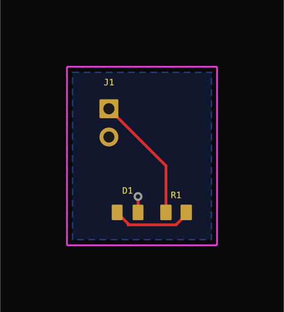
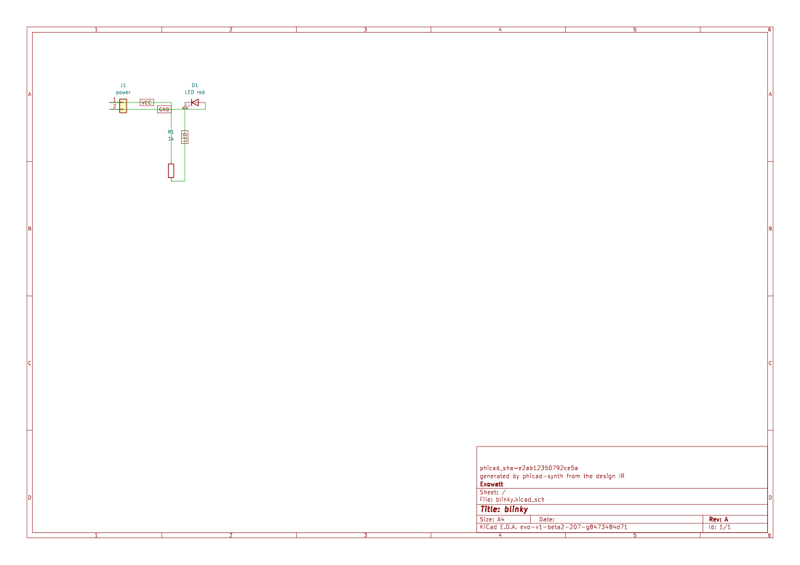
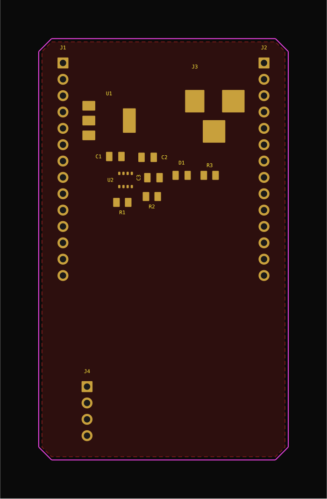
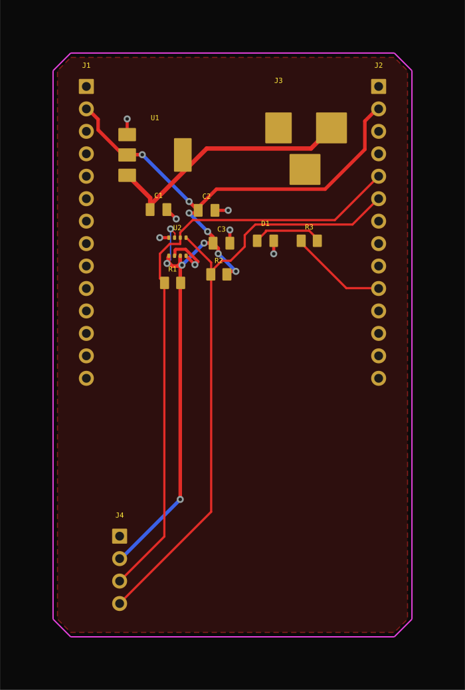

# PhiCad product tour

PhiCad has two stories, and this tour keeps them separate:

- **Current build output** is the part you can reproduce now with the commands in this guide. It
  uses the real boards, schematics, videos, and gate results shipped under
  `docs/assets/getting-started/`.
- **Product direction** is a labeled look at where the desktop experience is going. Only the
  Studio composition is treated as concept imagery; product screenshots elsewhere on this page
  are current build evidence.

The result is a visual map without turning a roadmap into a release note.

## Choose your route

<div class="grid cards" markdown>

- :material-compass-outline: **New user**

    Start with the [getting-started guide](getting-started.md). You will install the fork, create
    a small design, run the gates, and learn where a generated board still needs review.

- :material-monitor-dashboard: **Desktop user**

    Go to [The application](the-application.md) to launch PhiCad, open the editors, and understand
    the Agent View entry point.

- :material-robot-outline: **Agent operator**

    Go to [Driving PhiCad](driving-phicad.md) for the MCP, `phicad tool`, Python, IPC, and raw
    `kicad-cli` paths.

</div>

If something is unclear or broken, use the [user feedback guide](feedback.md). Maintainers use
the [feedback administration reference](../reference/feedback-admin.md).

## The short version

### Current build output: describe → place → route → inspect

The shortest real workflow is:

```bash
phicad new blinky
phicad check blinky.json
phicad build blinky.json
phicad snapshot blinky-out/blinky.kicad_pcb --png
```

The first command writes a design that builds as-is. The next command validates the design in
milliseconds. `build` produces ordinary KiCad project files, runs the synthesis stages, and
reports the evidence for each gate. `snapshot` renders the board so that a result can be inspected
without opening the GUI.

<video controls muted playsinline preload="metadata"
       poster="../../assets/getting-started/blinky-board.png"
       style="width:100%;max-width:900px;border-radius:8px">
  <source src="../../assets/getting-started/cli-demo.mp4" type="video/mp4">
  Your browser cannot play this video; the same sequence is transcribed in
  <a href="getting-started/#cli-demo-transcript">Getting started</a>.
</video>

<p><strong>Caption:</strong> a terminal creates the Blinky design, checks it, builds the board,
 and arrives at a rendered KiCad result. <a href="getting-started/#cli-demo-transcript">Read
the transcript</a>.</p>

## A visual pass through a real build

Everything in this section is **current build output**. The images are outputs of the pipeline,
not mockups of a future UI.

### 1. Start from a circuit description

The design is a JSON intent document: parts, nets, board rules, and placement relationships. It
uses constraints such as `near`, `within`, `group`, and `edge` rather than hand-written X/Y
coordinates. The full design IR and its validation errors are in [Getting started](getting-started.md#the-design-ir).

### 2. Get ordinary KiCad files

| Board output | Schematic output |
| --- | --- |
|  |  |
| A small, routed board from `phicad new blinky`. | A real `.kicad_sch` that can be opened and edited in Eeschema. |

These are not screenshots of a proprietary intermediate format. The output is a KiCad project,
and the generated schematic is fingerprinted so a rebuild refuses to overwrite hand edits.

### 3. See placement before trusting routing



*Current build output after `place`: components are clustered by the declared `group` and `near`
constraints, and the outline is shrink-wrapped around them.*



*Current build output after `route`, `fill`, and `silk`: copper, vias, ground stitches, and the
poured zone are visible in the rendered board.*

The larger carrier run is deliberately useful as a warning. It reaches **13 of 14 stages**: DRC
finds a genuine short that the router reported as successfully routed. A generated board is a
draft to review, not a fabrication release. The [Getting started limitations](getting-started.md#known-limitations)
and [gate guide](getting-started.md#which-gate-to-believe) keep the complete, unchanged details in
one place.

### 4. Read the evidence, not just the headline

<video controls muted playsinline preload="metadata"
       poster="../../assets/getting-started/phase3-routed.png"
       style="width:100%;max-width:900px;border-radius:8px">
  <source src="../../assets/getting-started/pipeline-demo.mp4" type="video/mp4">
  Your browser cannot play this video; the same output is transcribed in
  <a href="getting-started/#pipeline-demo-transcript">Getting started</a>.
</video>

<p><strong>Caption:</strong> the synthesis stages stream from validation through placement,
routing, fill, and DRC; the final gate reports its evidence instead of hiding a violation.
<a href="getting-started/#pipeline-demo-transcript">Read the transcript</a>.</p>

A `PASS` means the gate ran and its evidence was good. `FAIL` means it found a real problem.
`SKIP` is an absent optional tool, and `BROKEN` counts as failure because the gate could not run.
Warnings do not fail the synth gate, and `kicad-cli pcb drc` can exit 0 while still finding
violations. Read the report. See [Which gate to believe](getting-started.md#which-gate-to-believe)
for the full contract and stable finding IDs.

## The desktop experience

**Current build output:** PhiCad is a desktop EDA application built from the KiCad 10.99 suite.
It includes the project manager, schematic editor, PCB editor, 3D viewer, Gerber viewer, and the
AI-native layer described in [The application](the-application.md). The application page is the
place to learn the launch command and the exact first-run behavior.

<figure>
  
  <figcaption><strong>Current build output — Agent View.</strong> A visual companion to the shipped
  plugin and its board-aware conversation entry point.</figcaption>
</figure>

For the current capability contract, see [The application](the-application.md). The intended
desktop loop is still easy to name: describe, synthesize, gate, iterate, and then
export. For the current commands and the boundary between chat writes and normal editor edits,
see [Designing a board inside the application](the-application.md#designing-a-board-inside-the-application).

## Product direction: the larger workspace

This panel is **product direction**, not current build output. It is included so readers can
recognize the intended shape of the product without confusing a concept with a shipped feature.

### Native 3D inspection — current build

<figure>
  
  <figcaption><strong>Current build output — native 3D.</strong> This is a real PhiCad 3D viewer
  rendering, not concept imagery. Generated footprints still lack STEP associations by default,
  so another generated project may show less component-body detail than this example.</figcaption>
</figure>

For the current application contract, use [The application](the-application.md), not these
images. For the exact current limitations — including the shelf packer, explicit layer count,
partial schematic wiring, router boundary, missing 3-D model binding, and tested platform — use
[Known limitations](getting-started.md#known-limitations).

## The operator experience

**Current build output:** the same capabilities can be driven without the GUI. An agent can use
MCP, a terminal through `phicad tool`, Python through the registry, or raw `kicad-cli` through the
wrapper. These are not four implementations: they reach the same registry and IPC surfaces.

Here is a copyable DRC example from the operator guide:

```bash
phicad tool call pcb_drc --arg board_path=/tmp/proj/board.kicad_pcb
# The process ran successfully; inspect the JSON violation count rather than treating exit 0 as clean.
```

Choose the right operator path in [Driving PhiCad](driving-phicad.md#which-one-to-use). The guide
also has copyable examples for schematic edits, fabrication packs, project history, setup, and
health checks.

## Support and feedback

Use the user-facing [feedback guide](feedback.md) to report a bug, request a feature, or suggest
a page improvement. Maintainers triage those reports through the
[feedback administration reference](../reference/feedback-admin.md); this tour is not a second
issue process.

When a report needs bounded diagnostics, generate and review the archive locally before sharing
it:

```bash
phicad support bundle [--project PATH] [--output PATH] [--json]
```

Older checkouts that do not recognize the command should use a text-only report rather than a
broad archive of local files or logs.

## Next steps

<div class="grid cards" markdown>

- :material-rocket-launch: **[Make the first board](getting-started.md)**

    Install PhiCad, run Blinky, inspect every gate, and read the limitations before trusting a
    generated project.

- :material-monitor: **[Open the desktop application](the-application.md)**

    Launch from the build tree, understand Agent View, and map GUI actions to headless commands.

- :material-console: **[Operate it from an agent](driving-phicad.md)**

    Use MCP, `phicad tool`, Python, IPC, or raw `kicad-cli` with machine-readable results.

- :material-message-alert-outline: **[Give feedback](feedback.md)**

    Prepare a bug, feature, or page-improvement draft locally, review it, and choose whether to
    submit it to the private queue.

</div>
