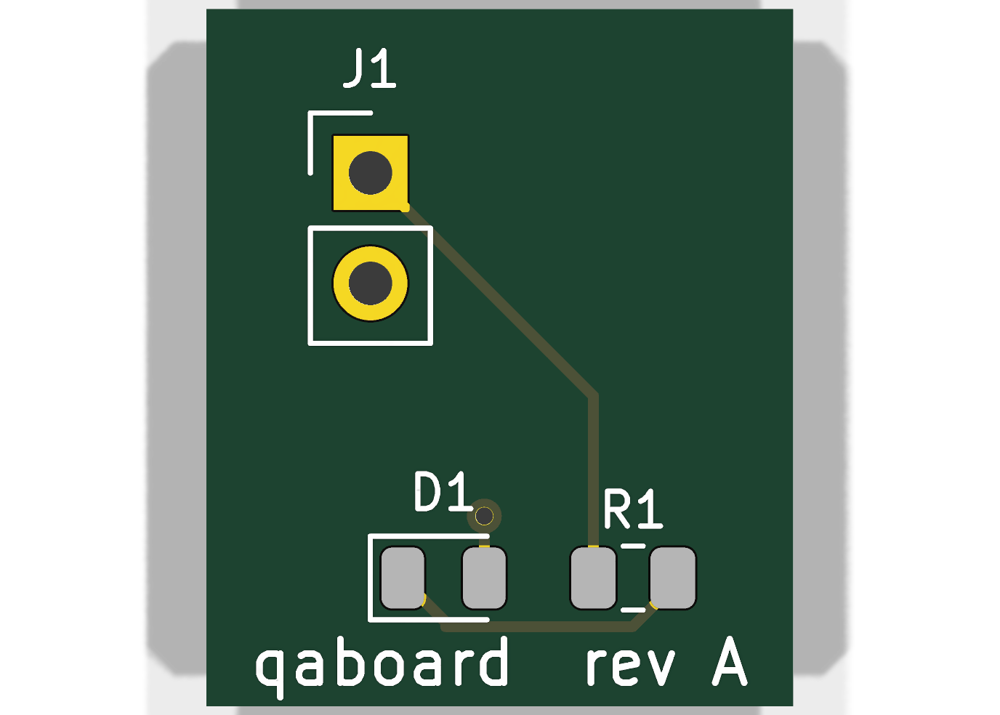
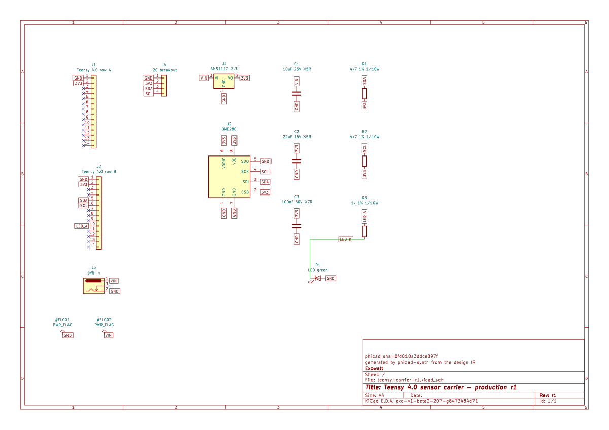
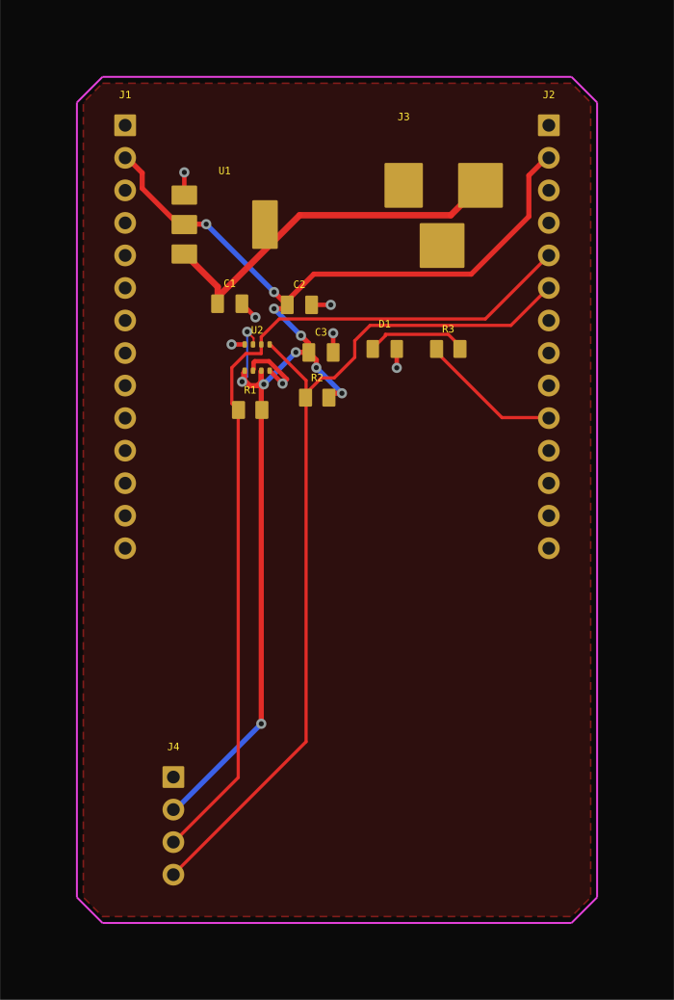
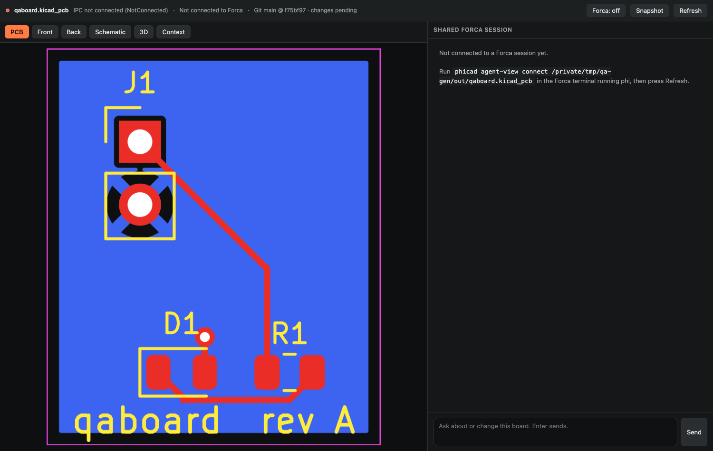

  <a class="landing-skip" href="#landing-content">Skip to PhiCad content</a>

  <nav class="product-nav" aria-label="PhiCad product navigation">
    

      <a class="product-brand" href="." aria-label="PhiCad home">
        
        <strong>PhiCad</strong>
      </a>
      

        <a href="#overview">Overview</a>
        <a href="#output">Output</a>
        <a href="#how">How it works</a>
        <a href="#direction">Direction</a>
      

      <a class="product-nav-cta" href="guides/getting-started/">Get started</a>
    

    
  </nav>

  <header class="landing-hero" id="landing-content">
    <svg class="hero-traces" viewBox="0 0 1600 900" preserveAspectRatio="none" aria-hidden="true">
      <path d="M0 700 H225 L345 580 H630 L760 450 H1030 L1185 295 H1600"></path>
      <path d="M0 785 H300 L425 660 H725 L830 555 H1110 L1280 385 H1600"></path>
      <circle cx="345" cy="580" r="7"></circle>
      <circle cx="760" cy="450" r="7"></circle>
      <circle cx="1185" cy="295" r="7"></circle>
    </svg>

    

      

      <figure class="hero-board-frame">
        
      </figure>
    

    

      

        
Electrical design, generated

        <h1 class="landing-reveal">
          Describe the circuit. 
          Inspect the board.
        </h1>
        
PhiCad turns circuit intent into a native KiCad project—with the schematic, PCB, 3D view, and named findings close enough to review.

        

          <a class="button button-primary" href="guides/getting-started/">Start with a real build</a>
          <a class="button button-ghost" href="#output">See the output</a>
        

        
 Real output from the current checkout. No concept UI in this hero.

      

    

    <a class="scroll-cue" href="#overview" aria-label="Scroll to the PhiCad product overview">
      Scroll to explore
      
    </a>
  </header>

  <section class="signal-band" id="overview" aria-label="Current PhiCad surface">
    

      
<b>1</b>Editable KiCad project from one design intent

      
<b>3</b>Native views: schematic, PCB, and 3D

      
<b>123</b>Documented MCP tools for agents and automation

      
<b>16</b>Tool sections across the design workflow

    

  </section>

  

    <section class="landing-section output-section" id="output" aria-labelledby="output-heading">
      

        

          

            
One project

            <h2 id="output-heading" class="landing-reveal">Every view stays close to the work.</h2>
          

          
The strongest proof is the project itself. These are current PhiCad outputs—not illustrations of what the product might do later.

        

        

          <figure class="output-card landing-reveal">
            

              
            

            <figcaption><b>Schematic</b>Native .kicad_sch · open and edit</figcaption>
          </figure>
          <figure class="output-card landing-reveal">
            

              
            

            <figcaption><b>PCB</b>Native .kicad_pcb · routed geometry</figcaption>
          </figure>
          <figure class="output-card landing-reveal">
            

              
            

            <figcaption><b>3D</b>Native renderer · physical review</figcaption>
          </figure>
          <figure class="output-card landing-reveal">
            

              
            

            <figcaption><b>Agent View</b>Board + project context · one surface</figcaption>
          </figure>
        

      

    </section>

    <section class="landing-section run-section" id="evidence" aria-labelledby="run-heading">
      

        

          
See the current build

          <h2 id="run-heading" class="landing-reveal">Watch the board take shape.</h2>
          
A real synthesis run moves through validation, placement, schematic generation, routing, fill, and native DRC evidence. The recording ends where the measured verdict ends.

        

        <figure class="run-feature landing-reveal">
          

            
Current build · intent → project

            <video controls muted playsinline preload="metadata" poster="assets/getting-started/phase3-routed.png" aria-describedby="pipeline-video-caption">
              <source src="assets/getting-started/pipeline-demo.mp4" type="video/mp4">
              Your browser cannot play this video. <a href="assets/getting-started/pipeline-demo.mp4">Download the pipeline recording</a> or <a href="#pipeline-video-transcript">read the transcript</a>.
            </video>
          

          <figcaption id="pipeline-video-caption">
            

              
A run you can repeat

              <h3>From description to native files.</h3>
            

            

              
The build writes an ordinary KiCad project and reports each gate independently. A failure stays visible instead of being softened into a success state.

              

                
Read the transcript

                
The terminal starts a PhiCad synthesis build, reports each stage independently, writes the KiCad project, and ends on the measured gate verdict before the routed board is inspected.

              

            

          </figcaption>
        </figure>
      

    </section>

    <section class="landing-section process-section" id="how" aria-labelledby="how-heading">
      

        

          
How it works

          <h2 id="how-heading" class="landing-reveal">Intent in. Evidence out.</h2>
          
The workflow keeps the generated geometry and the reason to trust—or reject—it in the same project.

          <a class="text-link landing-reveal" href="reference/synth/">Read about board synthesis →</a>
        

        <ol class="process-steps">
          <li class="landing-reveal">
            01
            
<h3>Describe</h3>
Record the circuit intent, constraints, parts, and connections in a reviewable design file.

          </li>
          <li class="landing-reveal">
            02
            
<h3>Compile</h3>
Generate native schematic and PCB files rather than a screenshot or a proprietary dead end.

          </li>
          <li class="landing-reveal">
            03
            
<h3>Route</h3>
Turn placement and connectivity into geometry that can be opened and changed in PhiCad or stock KiCad.

          </li>
          <li class="landing-reveal">
            04
            
<h3>Prove</h3>
Read each check independently. A clean DRC is evidence—not an automatic fabrication guarantee.

          </li>
        </ol>
      

    </section>

    <section class="landing-section proof-section" aria-labelledby="proof-heading">
      

        

          
The handoff

          <h2 id="proof-heading" class="landing-reveal">A project, not a picture.</h2>
          
Open the output in PhiCad—or in stock KiCad—and continue by hand. Generated boards remain drafts to review, with the findings and limitations left attached.

          

            <a class="button button-primary" href="guides/getting-started/">Follow a real run</a>
            <a class="text-link" href="reference/testing/">See the testing approach →</a>
          

        

        

          
01
<h3>Editable</h3>
Native files stay in the familiar KiCad workflow.

          
02
<h3>Local project</h3>
Board and schematic files stay on your machine by default; AI requests use your authenticated Phi identity.

          
03
<h3>Traceable</h3>
Findings carry evidence about the item, layer, and location involved.

        

      

    </section>

    <section class="landing-section direction-section" id="direction" aria-labelledby="direction-heading">
      

        

          

            
What comes next

            <h2 id="direction-heading" class="landing-reveal">A broader surface is taking shape.</h2>
          

          
The Studio concept explores a more connected way to move through schematic, PCB, 3D, BOM, and DRC views. It is product direction—not the authority for a fabrication handoff.

        

      

    </section>

    <section class="landing-section start-section" aria-labelledby="start-heading">
      

        

          

            
Start here

            <h2 id="start-heading" class="landing-reveal">Choose your next move.</h2>
          

          
One project, several ways in. Start with the <a href="guides/product-tour/">visual product tour</a> or choose the route that matches your work.

        

        <nav class="route-grid" aria-label="PhiCad documentation routes">
          <a class="route-card route-card-featured landing-reveal" href="guides/getting-started/">
            First run<h3>Getting started</h3>
Build a design and learn how to read its gates.
↗
          </a>
          <a class="route-card landing-reveal" href="guides/the-application/">
            In the editor<h3>The application</h3>
Find the GUI, Agent View, and native editing loop.
↗
          </a>
          <a class="route-card landing-reveal" href="guides/driving-phicad/">
            From a shell<h3>Drive PhiCad</h3>
Use the CLI, an agent, or an MCP client.
↗
          </a>
          <a class="route-card landing-reveal" href="reference/architecture/">
            Under the hood<h3>Reference</h3>
Understand the interfaces, architecture, and boundaries.
↗
          </a>
        </nav>
      

    </section>

    <section class="landing-cta" aria-labelledby="cta-heading">
      

        

          
Try it on a real circuit

          <h2 id="cta-heading" class="landing-reveal">Bring the design you need to inspect.</h2>
        

        

          
Start with a small board, keep every generated file, and decide from the evidence whether it is ready for the next step.

          

            <a class="button button-invert" href="guides/getting-started/">Build the example</a>
            <a class="button button-outline" href="guides/product-tour/">Take the product tour</a>
          

        

      

    </section>
  

  <footer class="landing-footer">
    

      

        
PhiCad is a fork of KiCad 10, with a local, evidence-led design loop.

      

      <nav class="footer-links" aria-label="PhiCad footer navigation">
        <a href="guides/getting-started/">Get started</a>
        <a href="reference/mcp-tools/">MCP tools</a>
        <a href="guides/feedback/">Feedback</a>
        <a href="reference/look-and-feel/">Look and feel</a>
        <a href="#top">Back to top ↑</a>
      </nav>
    

  </footer>

